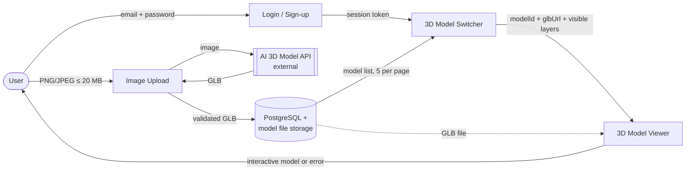

# Web-Based Interactive Model Visualizer

**Team AVJS** · CS 5001 / 5002 Senior Design · University of Cincinnati

> **Goal:** Create a web-based model visualizer that allows users to quickly change layers of the model as well as create models based on images uploaded via AI.

This project builds an AI-assisted WebGL tool for viewing and exploring volumetric data in the browser. A user can upload an image, have it turned into a 3D model, save it to their account, and then rotate, zoom, and switch between layers of the model. Example uses include brain cross-sections for medical students, rock and sediment layers for geologists, powertrain parts for engineers, and building floors for emergency responders.

---

## Team

| Member | GitHub | Component Owner |
|---|---|---|
| Abby Kraft | [@abkatchill](https://github.com/abkatchill) | Image Upload |
| Veronica Malusky | [@maluskvp](https://github.com/maluskvp) | Login / Sign-up |
| Jake Martin | [@jakeMartin614](https://github.com/jakeMartin614) | 3D Model Switcher |
| Sophia Munoz | [@munozsophia](https://github.com/munozsophia) | 3D Model Viewer |

**Advisor:** Professor Ming Tang

Full contact details and bios are in [Project_Description.md](Project_Description.md).

---

## How it works



| Component | Responsibility |
|---|---|
| **Login / Sign-up** | Authenticates the user and issues a session token so models are saved to their own account. |
| **Image Upload** | Validates an uploaded image, sends it to the AI service, and checks the returned 3D model (GLB) before saving it. |
| **3D Model Switcher** | Shows the user's saved models a page at a time and lets them pick one and choose which layers are visible. |
| **3D Model Viewer** | Renders the selected model in the browser so the user can rotate, zoom, and switch layers, and shows a clear error if it can't. |

Architecture: **client-server** for login, storage, and the switcher; a **pipeline** for image → AI → validated GLB; and a **layered**, client-side design for the viewer. The reasoning is in the design documents below.

Every component now has a data model, defined behavior, an interface with error codes, and documented edge cases (D2).

---

## Repository contents

```
.
├── README.md                  ← you are here
├── Project_Description.md     Team members and project topic
├── Constraints_Essay.md       Economic, social, and professional constraints
├── User_Stories.md            Stakeholder map, user stories US-01 to US-05, use case UC-01
├── Tasklist.md                20 implementation tasks (T1–T20), each with one owner
├── Requirements_Document.md   Functional and non-functional requirements, MoSCoW, constraints
├── Technical_Specification.md Interfaces, technology stack, traceability matrix
├── bios/                      Team member professional bios
├── Planning/
│   └── Milestones_Timeline_and_Effort_Matrix.pdf   Milestones, timeline, effort matrix, WBS, risk register
└── Design_Diagrams/
    ├── D0_High_Level_Design.pdf    Components, interfaces, data flow, architecture patterns
    ├── D1_Detailed_Design.pdf      Data model, core algorithms, build vs. reuse, API, tech choices
    ├── D2_Detailed_Design.pdf      Remaining components, edge cases, traceability, rationale
    └── Peer_Review_Notes.md        Feedback from two reviewing teams, with action items
```

### Design documents

| Document | Week | Status |
|---|---|---|
| [D0 – High-Level Design](Design_Diagrams/D0_High_Level_Design.pdf) | 5 | ✅ Submitted |
| [D1 – Detailed Design, Part 1](Design_Diagrams/D1_Detailed_Design.pdf) | 6 | ✅ Submitted |
| [D2 – Detailed Design, Part 2](Design_Diagrams/D2_Detailed_Design.pdf) | 7 | ✅ Submitted |
| [Peer Design Review Notes](Design_Diagrams/Peer_Review_Notes.md) | 7 | ✅ Submitted; second team's review added Week 9 |

Together with the user stories, D0–D2 make up the Assignment #4 design package. The design phase is now closed, and each component has been turned into tasks in the [project plan](#project-plan).

### Planning and specification documents

| Document | Week | Status |
|---|---|---|
| [Task List](Tasklist.md) | 8 | ✅ Submitted |
| [Milestones, Timeline, and Effort Matrix](Planning/Milestones_Timeline_and_Effort_Matrix.pdf) | 8 | ✅ Submitted |
| [Requirements Document](Requirements_Document.md) | 9 | ✅ Submitted |
| [Technical Specification](Technical_Specification.md) | 9 | ✅ Submitted |

---

## Project plan

Each member owns five tasks for their component. The full schedule, effort matrix, and risk register are in the [planning document](Planning/Milestones_Timeline_and_Effort_Matrix.pdf).

| Tasks | Owner | Component | Implementation window |
|---|---|---|---|
| [T1–T5](Tasklist.md) | Abby Kraft | Image Upload | Jan – Mar 2027 |
| [T6–T10](Tasklist.md) | Veronica Malusky | Login / Sign-up | Jan – Feb 2027 |
| [T11–T15](Tasklist.md) | Jake Martin | 3D Model Switcher | Jan – Mar 2027 |
| [T16–T20](Tasklist.md) | Sophia Munoz | 3D Model Viewer | Nov 2026 – Mar 2027 |

**Key dates**

| Date | Milestone |
|---|---|
| Fall 2026 | Course deliverables through the Design Report (12/2) and advisor assessments (12/8) |
| Jan 2027 | Backends, front-end logic, and model loading in place |
| Feb 2027 | Generation pipeline working; components feature-complete |
| Mar 2027 | Components tested and integrated end to end |
| **Apr 13, 2027** | **CEAS Expo** |

---

## Requirements at a glance

The [Requirements Document](Requirements_Document.md) defines **11 functional requirements** (REQ-01 to REQ-11), **7 non-functional requirements** (NFR-01 to NFR-07), and **3 constraints** (CON-01 to CON-03). The [Technical Specification](Technical_Specification.md) traces each one to a D0–D2 design element.

| Must have | Won't have (this release) |
|---|---|
| Accounts with private, saved models | Prompt-based model generation |
| Upload an image and get a 3D model | Immersive avatar walkthrough |
| Switch between saved models | Sharing models between users |
| Rotate, zoom, pan, and show or hide layers | |
| A model of up to 50 MB shown within 15 seconds | |

---

## Tech stack

Chosen and justified in D1 and the [Technical Specification](Technical_Specification.md).

| Layer | Choice |
|---|---|
| Front end | React with Ant Design (upload UI) |
| 3D rendering | WebGL in the browser (client-side), library chosen in task T16 |
| Model format | GLB (binary glTF) |
| Database | PostgreSQL (users, models, layers, generation jobs) |
| File storage | GLB files stored separately; the database keeps their URLs |
| Authentication | Hashed passwords and session tokens |
| 3D generation | Hosted AI image-to-3D API, chosen in task T1 |

---

## Open questions

Carried forward from D2, the peer reviews, and the Requirements Document:

- How a single uploaded image produces the separate layers the viewer displays.
- Which AI image-to-3D service to use, and a backup plan if its results are poor (to be decided in task T1, by 1/13/2027).
- Whether the system will handle volumetric files (such as .nrrd or .nii.gz) as well as GLB, and how volumetric models would be generated (Q-02 to Q-04).
- Whether users can import an existing GLB file directly (REQ-07, not yet designed).

---

## Course milestones

**CS 5001 · Fall 2026 (Define & Design)**

- [x] Professional Biographies
- [x] Team Formation and Project Description
- [x] Advisor Selection and Constraints Essay
- [x] User Stories and Use Cases
- [x] D0 – High-Level Architecture
- [x] D1 – Detailed Design, Part 1
- [x] D2 – Detailed Design, Part 2, and Peer Design Review
- [x] Task List, Milestones, Timeline, and Effort Matrix
- [x] Requirements Document and Technical Specification
- [ ] Test and Validation Plan (11/4)
- [ ] Ethics and Responsible-Use Statement (11/11)
- [ ] Oral Presentation and Recorded Video (11/18)
- [ ] Design Report, Design Notebook, and Assessments (12/2)

**CS 5002 · Spring 2027 (Build & Deliver)**

- [ ] Implementation of All Four Components
- [ ] Integration and Testing
- [ ] CEAS Expo (4/13/2027)